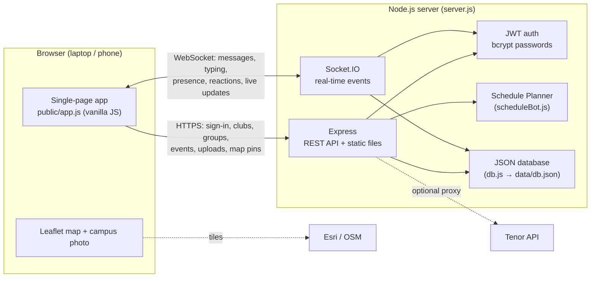

# 💜 VEYA: IIT Mandi's real-time campus app

VEYA puts IIT Mandi's clubs, chats, groups, events, attendance and campus map in one web app. It works on laptops and phones in the browser, with no app store install.

- **Real-time chat** for campus channels, society lounges (SnTC, Cult Soc, Sports, Extra Curriculars), every club, user-made groups and direct messages
- **Clubs page**: join, leave and create clubs
- **Groups** for freshers, branches, batches, hostels and projects
- **Updates**: events with RSVP and clash warnings
- **QR attendance** for events
- **Schedule Planner**: timetable clash checker
- **Interactive campus map** built from a labelled campus photo, plus satellite view
- **💚 Care**: Guidance & Counselling page
- Themes, profile photos, online status, emojis, stickers and GIFs

---

## Contents

1. [Quick start](#1-quick-start)
2. [Configuration (environment variables)](#2-configuration-environment-variables)
3. [External services](#3-external-services)
4. [Architecture](#4-architecture)
5. [Real-time communication](#5-real-time-communication)
6. [Features](#6-features)
7. [Reproducing and testing in a clean environment](#7-reproducing-and-testing-in-a-clean-environment)
8. [Project structure](#8-project-structure)
9. [Security notes](#9-security-notes)
10. [Limitations and future work](#10-limitations-and-future-work)

---

## 1. Quick start

**Requirements:** [Node.js](https://nodejs.org) **18 or newer** (the LTS version is recommended). That's all: there's no database server, no build step and no API keys to set up.

```bash
git clone <this-repo-url> veya
cd veya
npm install        # installs dependencies (first time only)
npm start          # starts the server
```

Open **http://localhost:3000** and click **Create account**.

- The **first account you create becomes a core-team admin**. Admins can post announcements and manage the core team.
- Passwords must be at least 8 characters with an uppercase letter, a lowercase letter, a number and a symbol (e.g. `Kamand@2026`).
- To try the real-time features, open a second browser (or a private window), create a second account, and chat between them.

**Open it from your phone or another device on the same Wi-Fi:**
1. Find your computer's IP address. On Windows run `ipconfig`; on Mac/Linux run `ipconfig getifaddr en0` or `hostname -I`.
2. On your phone, open `http://<that-ip>:3000`, for example `http://192.168.1.5:3000`.

**Stop the server** with `Ctrl+C`. All data is saved in `data/db.json` and is still there the next time you run `npm start`.

**Development mode** (restarts automatically when you edit `server.js`): `npm run dev`

---

## 2. Configuration (environment variables)

All settings are **optional**. VEYA runs with no configuration.

| Variable | Default | What it does |
|---|---|---|
| `PORT` | `3000` | Port the web server listens on. |
| `JWT_SECRET` | random, generated on first run and stored in `data/db.json` | Secret used to sign login tokens. **Set this in production** so logins survive a database reset. |
| `DB_FILE` | `data/db.json` | Where the JSON database is stored. Uploaded images go in an `uploads/` folder next to it. |
| `ADMIN_USERNAMES` | *(empty)* | Comma-separated usernames that are always core-team admins, e.g. `riya,arun`. |
| `ALLOWED_EMAIL_DOMAIN` | *(empty)* | Restricts sign-up to one email domain, e.g. `students.iitmandi.ac.in`. |
| `TENOR_API_KEY` | *(empty)* | Turns on Tenor GIF and sticker search. An admin can also paste the key in the app instead (see below). |

How to set them:

```bash
# Mac / Linux
PORT=4000 ADMIN_USERNAMES=riya npm start

# Windows PowerShell
$env:PORT="4000"; $env:ADMIN_USERNAMES="riya"; npm start

# Windows Command Prompt
set PORT=4000 && set ADMIN_USERNAMES=riya && npm start
```

---

## 3. External services

VEYA works **fully offline on a local network**. The map libraries and QR library are bundled in `public/vendor/`, so nothing is loaded from a CDN. A few optional features use outside services when the internet is available:

| Service | Used for | Needs a key? | If it's unavailable |
|---|---|---|---|
| **Tenor API v2** (Google) | GIF and sticker search in chat | Yes, free (see below) | GIF/sticker search is hidden. Built-in stickers and user uploads still work. |
| **Esri World Imagery** | 🛰️ Satellite map tiles | No | The 📷 Campus photo and 🏫 Drawn maps still work offline. |
| **OpenStreetMap** | "Streets" layer on the satellite map | No | Same as above. |
| **Google Maps** (links only) | "🧭 Directions" button opens Google Maps | No | Only the link is affected. |

**Turning on Tenor GIFs and stickers (optional, about 2 minutes, free):**
1. Go to [console.cloud.google.com](https://console.cloud.google.com), sign in and create a project (any name).
2. Search for **Tenor API** and click **Enable**.
3. Go to **APIs & Services → Credentials → Create credentials → API key**, then copy the key. You can also restrict the key to the Tenor API only.
4. In VEYA, sign in as an admin, open **Profile & settings → GIF & sticker library (Tenor)**, paste the key and click **Connect**.

VEYA checks the key with Tenor and saves it on the server. Search turns on for everyone without a restart. The key is **never sent to browsers**: all Tenor requests go through the VEYA server (`/api/tenor`).

---

## 4. Architecture

VEYA is a single Node.js process that serves the web app, a REST API and a WebSocket (Socket.IO) server on the same port.



**Server (Node.js + Express + Socket.IO)**
- `server.js` holds the REST API, Socket.IO handlers, permission checks and rate limiting.
- `db.js` is a small JSON-file database. Writes are batched (250 ms debounce) and saved atomically (written to a temporary file, then renamed), so a crash can't leave a half-written file.
- `seed.js` defines the communities and clubs (SnTC, Cult Soc, Sports, Extra Curriculars, Campus) with descriptions and sample events.
- `scheduleBot.js` is the Schedule Planner: clash detection, free-slot finder and a simple command parser.

**Client (no framework, no build step)**
- `public/index.html` loads plain JavaScript files: `app.js` (the whole UI), `campus.js` (map data), `gcs.js` (counselling contacts), `emoji.js` and `stickers.js`.
- The UI is built with a small `h()` helper that always uses `textContent` for user text, so chat messages can't inject HTML (XSS-safe).
- Themes are CSS variables in `styles.css`.

**Data model** (everything is in `data/db.json`):

| Collection | Contents |
|---|---|
| `users` | Profile, bcrypt password hash, role, status, blocked/muted/pinned lists, profile details |
| `messages` | `roomId → [messages]`. The newest 1000 messages are kept per room. |
| `clubs`, `members` | User-created clubs and club memberships |
| `groups` | User-created groups: members, admins, join requests, public/private |
| `events` | Events with RSVPs, attendance codes and check-ins |
| `schedules` | Each user's Schedule Planner items |
| `stickers`, `places`, `settings` | Community stickers, shared map pins, admin settings (e.g. Tenor key) |

**Room naming** (used by both REST and Socket.IO):
- `campus/general`, `sntc/robotronics`: community channels and clubs from `seed.js`
- `club/<id>`: user-created clubs
- `group/<id>`: user-created groups (members only)
- `dm:<userA>:<userB>`: direct messages

---

## 5. Real-time communication

VEYA uses **[Socket.IO](https://socket.io) 4**, which runs over **WebSockets** and falls back to HTTP long-polling on networks that block WebSockets.

**How it works**
1. After signing in, the browser opens a Socket.IO connection and sends its JWT in the handshake (`auth.token`). The server verifies it and rejects connections without a valid token.
2. The server adds the socket to the rooms the user is allowed in: every community channel and club, the private groups they belong to, and a personal `user:<id>` room for DMs and notifications.
3. When a user sends a message, the server checks permissions (room access, admin-only announcements, blocked users), saves it, then broadcasts it **only to that room**.
4. If a user is added to or removed from a group, the server moves all of their open sockets (every tab and device) into or out of the group's room straight away.

**Events from the client to the server**

| Event | Purpose |
|---|---|
| `message:send` | Send a text, sticker, GIF or image message (with an acknowledgement callback) |
| `message:react`, `message:pin`, `message:delete` | Reactions, pinning, deleting |
| `typing` | "… is typing" indicator |
| `idle` | Marks the user as Away after inactivity |

**Events from the server to the client**

| Event | Purpose |
|---|---|
| `message:new` / message updates | New messages, reactions, pins, deletions |
| `typing` | Typing indicator |
| `presence` | Online / Away / Do not disturb / Invisible, and last seen |
| `user:new`, `user:update` | New members, profile changes |
| `clubs:changed`, `club:members` | Club list and membership changes |
| `groups:changed`, `groups:request`, `groups:approved` | Group updates, join requests to admins, approvals |
| `events:changed`, `events:rsvp`, `events:attendance` | Event updates, RSVPs, live check-in counter |
| `places:changed`, `stickers:changed`, `settings:changed` | Shared map pins, community stickers, admin settings |

**Abuse protection:** at most 8 messages per 5 seconds per connection, a 2000-character message limit, a 100 KB Socket.IO payload limit, and rate limits on sign-in, sign-up, check-in and map pins.

---

## 6. Features

### Accounts and profiles
- Sign-up and sign-in with password rules. Passwords are hashed with bcrypt, and logins use a JWT (valid for 30 days).
- "Welcome to VEYA" start screen, then "Welcome, {name}" after signing in.
- Profile photo, bio, status (Online / Away / Do not disturb / Invisible) and a custom status message.
- **Profile details:** branch, batch (B23…), belonging to (hometown or state), club interests and passions. People search understands short forms like "cse" and "B23".
- Ten themes: VEYA Night (default), VEYA Day and eight Kamand-valley themes. Your choice is saved to your account.

### Chats
- Campus channels, society lounges, club chats, groups and direct messages.
- Live delivery, typing indicators, @mentions, reactions, pin, mute and block.
- Emoji picker, the built-in VEYA sticker pack, **community stickers** (anyone can upload), image and GIF uploads, and Tenor GIF/sticker search when a key is set.
- **#announcements** is read-only for everyone except **core-team admins**, who have a CORE badge. Admins add or remove core-team members in **Profile & settings → Core team**.

### Clubs
- A card grid of every SnTC, Cult Soc (including the Literary Society: Uhl Lekh, Qurosity, TSOD, Griffinsight), Sports, Extra Curriculars (HnT, NSO, NSS, NCC) and campus club, with descriptions from IIT Mandi pages.
- Filter by category, search, **Join**, **Details** (members, leave, open chat) and **New club**.

### 👥 Groups
- Anyone can create a group for a freshers batch, branch, batch, hostel, course or project.
- **Suggested for you:** based on your batch and branch, e.g. *Freshers B26*, *B26 Batch*, *CSE B26*, *CSE (all batches)*. One tap creates or joins the group.
- **Public** groups can be joined by anyone. **Private** groups need an admin's approval, and pending requests show as a badge on the Groups button.
- Group admins can add or remove people, make others admins, edit the group or delete it. Messages are visible only to members, and the server enforces this.

### Updates and events
- Upcoming events with RSVP, warnings when an event clashes with your timetable, and venue clash checks when creating events.

### 📷 QR attendance
1. The organiser (or an admin) opens an event and taps **Attendance QR**. A QR code and a 6-letter code appear.
2. Students scan the QR with their phone camera, or type the code, and are checked in automatically. If they're signed out, check-in happens right after they sign in.
3. Check-in is open from 1 hour before the start until 1 hour after the end.
4. The organiser sees a live list and can download it as a CSV. **New code** makes the old QR stop working.

> Phones must be able to reach the server, so show the QR from the Wi-Fi IP address or a public URL, not from `localhost`.

### 🗓️ Schedule Planner
- Add classes and club meetings, get clash warnings and find free slots. Events you RSVP to are included.

### 🗺️ Campus map
- **📷 Campus photo (default):** the labelled North Campus photo, made interactive. Tap a building, or search, to zoom in and highlight it.
- **🏫 Drawn:** a clean drawing of the same layout.
- **🛰️ Satellite:** every building as a pin on satellite imagery, with North/South campus buttons, directions and "my location".
- Search for "B-19", "Pine Mess", "library" or "doctor" to see the place plus nearby places with walking times.
- **Ganga and Saraswati** hostels are shown west of the Gym. Other named hostels have a **"Which block is this hostel in?"** picker that links them to a B-block for everyone.
- Students can pin missing places or **➕ Add a missing place**.

### 💚 Care (Guidance & Counselling)
- IIT Mandi GCS contacts, offices and team, a pre-filled email to request a session, and a link to the official form.
- Emergency helplines (Tele-MANAS 14416, 112) and two short self-help exercises.
- Contacts are kept in `public/gcs.js` so they're easy to update.

---

## 7. Reproducing and testing in a clean environment

### Option A: automated test (recommended, about 10 seconds)

```bash
git clone <this-repo-url> veya
cd veya
npm install
npm test
```

`npm test` uses Node's built-in test runner. It starts the **real server** on a free port with a **throwaway temporary database**, so your `data/` folder is never touched. It then checks:

| # | What's tested |
|---|---|
| 1 | The web app and `/api/health` are served |
| 2 | Weak passwords are rejected at sign-up |
| 3 | Sign-up and sign-in work, and the first account becomes admin |
| 4 | The API rejects missing or invalid tokens |
| 5 | Communities (Campus, SnTC, Cult Soc, Sports, Extra Curriculars) load |
| 6 | **Real-time:** a message from user A reaches user B over Socket.IO |
| 7 | Only admins can post in #announcements |
| 8 | Private groups: join request → approval → member-only messaging |
| 9 | QR attendance: wrong code rejected, right code checks the student in |
| 10 | The Schedule Planner detects a timetable clash |

Expected output ends with `# pass 10` and `# fail 0`.

### Option B: manual walkthrough

1. Start fresh with `npm install`, then `npm start`. Make sure there's no `data/` folder, or delete it first to reset everything.
2. Open http://localhost:3000 and **create account 1**, which becomes the admin.
3. Open a **private/incognito window** and **create account 2**.
4. **Chat:** both accounts open **Chats → Campus Lounge** and send messages. They appear instantly in the other window, with typing indicators and reactions.
5. **Announcements:** account 2 can't type in #announcements, but account 1 can.
6. **Clubs:** open **Clubs**, join a club, then open its chat.
7. **Groups:** account 1 creates a **private** group. Account 2 asks to join it. Account 1 sees a badge on **Groups**, approves the request, and both can chat in the group.
8. **QR attendance:** account 1 creates an event in **Updates** starting within the next hour, then taps **Attendance QR**. Account 2 opens the event, taps **Check in** and types the code. The organiser's list updates live.
9. **Planner:** add two classes at the same time on the same day. A clash warning appears.
10. **Map:** search "B-19" or "Ganga" and tap buildings. Switch between 📷, 🏫 and 🛰️.

### Option C: Docker (optional)

If you'd rather not install Node.js, this works with Docker installed:

```bash
docker run --rm -it -p 3000:3000 -v "$PWD":/app -w /app node:20 sh -c "npm install && npm test && npm start"
```

---

## 8. Project structure

```
veya/
├── server.js          Express REST API + Socket.IO server (auth, chat, clubs, groups, events, attendance, map, stickers, Tenor proxy)
├── db.js              JSON-file database with batched, atomic saves
├── seed.js            Communities, clubs and descriptions, plus sample events
├── scheduleBot.js     Schedule Planner (clash detection, free slots)
├── package.json       Dependencies and npm scripts (start, dev, test)
├── test/
│   └── smoke.test.js  End-to-end tests (npm test)
├── public/            Everything the browser loads (no build step)
│   ├── index.html     App shell, auth screens
│   ├── app.js         The whole single-page app
│   ├── styles.css     Layout and 10 themes
│   ├── campus.js      Map places, campus-photo coordinates, drawn map
│   ├── gcs.js         Guidance & Counselling contacts
│   ├── emoji.js, stickers.js   Emoji list and VEYA sticker pack
│   ├── img/           Logo, favicon, labelled North Campus image
│   └── vendor/        Leaflet 1.9.4 and qrcode-generator 1.4.4 (both MIT)
└── data/              Created at runtime (database + uploads). Not committed to git.
```

**Dependencies:** `express` (web server), `socket.io` (real-time), `bcryptjs` (password hashing), `jsonwebtoken` (login tokens). Dev only: `socket.io-client` (tests).

---

## 9. Security notes

- Passwords are hashed with bcrypt and never stored or sent in plain text.
- Every REST endpoint and Socket.IO connection checks the JWT. Room access (private groups, DMs, admin-only channels) is enforced **on the server**, not only hidden in the UI.
- User text is always rendered as text, never as HTML (XSS-safe).
- Uploads are limited to images (PNG, JPG, GIF, WebP) and stored with random file names. Remote media is accepted only from Tenor's media servers.
- The Tenor API key stays on the server.
- `data/` (accounts, chats, secret, keys) is in `.gitignore`. **Never commit it.**

---

## 10. Limitations and future work

- **Database:** the JSON-file database is fine for a demo or a few hundred users. For the whole campus, replace `db.js` with MongoDB or PostgreSQL. The rest of the code accesses data through `D.*`, so the change is contained.
- **Scaling:** one server process. To run several, add the Socket.IO Redis adapter.
- **Map:** Ganga and Saraswati outlines are approximate because they're outside the reference photo. South Campus appears only on the 🛰️ Satellite view.
- **Content:** SAIC has a neutral placeholder description. The NSO, NSS and NCC lines describe the national programmes in general. Edit them in `seed.js`.
